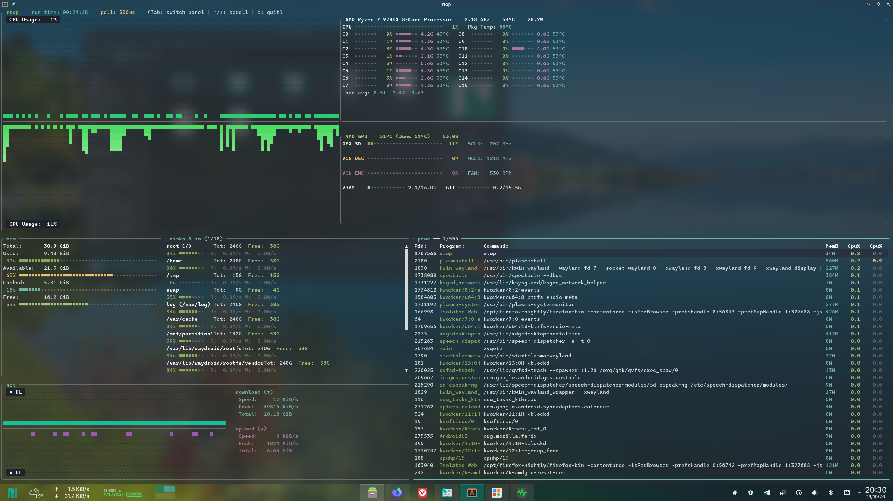

# rtop

A Linux TUI system monitor written in Rust, heavily inspired by **btop**'s design.

I made `rtop` because I wanted a system monitor that showed more AMD GPU telemetry—particularly **VCN video decode and encode activity**—alongside the usual CPU, memory, network, storage, and process information. I couldn't find another tool that gave me the combination and layout I wanted, so I built my own. The design is inspired by `btop`, including its emphasis on keeping monitoring overhead reasonable.



## Features

- **CPU:** overall usage history, per-core utilization and frequency, temperatures where exposed by the system, and package power where available.
- **AMD GPU:** GFX utilization, VCN decode and encode activity, VRAM and GTT usage, temperatures, power, clock speeds, and fan speed where exposed by the driver.
- **Memory:** total, used, available, cached, and free memory, with visual usage bars.
- **Storage:** mounted filesystem capacity and usage, plus read/write throughput.
- **Network:** download and upload graphs, current and peak throughput, and cumulative traffic totals.
- **Processes:** PID, program name, command line, memory usage, CPU usage, and estimated per-process GPU activity.
- **Compact dashboard:** the main system metrics are visible together, with history graphs and a refresh interval of approximately 500 ms.

## Compatibility

`rtop` is designed for **Linux**. Its system metrics use Linux interfaces such as `/proc` and `/sys`.

GPU monitoring is implemented for **AMD GPUs using the Linux `amdgpu` driver**. I don't have NVIDIA or Intel GPUs available for development and testing, so support for those vendors is not planned. Please don't open issues requesting support for non-AMD GPUs.

Some readings—especially VCN and per-process GPU activity, as well as temperatures, power, clocks, and fan speed—depend on the information exposed by your kernel, driver, and hardware. If a counter or sensor is unavailable, the corresponding value may be zero or inaccurate.

## Installation

### Requirements

- Linux
- Rust and Cargo (the stable toolchain is recommended)
- An AMD GPU using the `amdgpu` kernel driver for AMD GPU telemetry

On Arch Linux or Manjaro, install Git and Rust with:

```bash
sudo pacman -S --needed git rust
```

On other distributions, install Git with your package manager and Rust/Cargo using [rustup](https://rustup.rs/) if they are not already available.

### Build and run from source

```bash
git clone https://github.com/Shaurya-Kalia/rtop.git
cd rtop
cargo build --release
./target/release/rtop
```

### Install to your Cargo bin directory

From inside the cloned repository, run:

```bash
cargo install --path .
```

Cargo normally installs the executable to `~/.cargo/bin`. Make sure that directory is in your `PATH`, then launch it with:

```bash
rtop
```

## Usage

`rtop` opens the dashboard directly in your terminal.

| Key | Action |
| --- | --- |
| `q` or `Esc` | Quit |
| `Tab` | Switch focus between the process and disk panels |
| `↑` / `↓` or `k` / `j` | Move the selection or scroll the focused panel |
| `Page Up` / `Page Down` | Scroll by several entries |

## Notes

- The dashboard samples telemetry approximately every 500 ms.
- VCN percentages are derived from available AMDGPU engine-time counters where possible. Exact reporting depends on kernel and driver support.
- This is a personal project built around the hardware and telemetry I can test. Reports of reproducible bugs on Linux with AMD GPUs are welcome; requests to add support for other GPU vendors are not.
